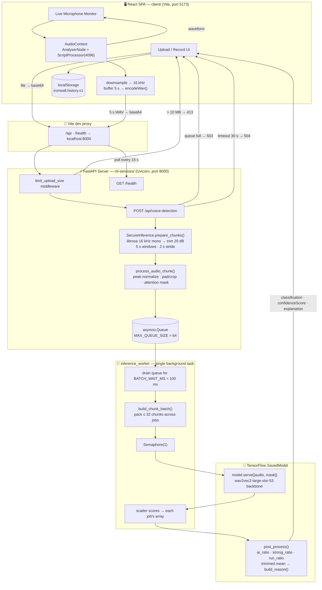

# 🛡️ IronWall AI — Audio Deepfake Detection

> **Defending truth in the age of generative AI.**
> A full-stack system that listens to an audio stream and decides whether the voice is **Human** or **AI-Generated** — with a confidence score and a human-readable explanation of *why*.

**Built by the IronWall AI team — Team `X-01`.**


---

## 📑 Table of Contents

1. [What this project is](#-what-this-project-is)
2. [Repository layout](#-repository-layout)
3. [Architecture at a glance](#-architecture-at-a-glance)
4. [End-to-end workflow](#-end-to-end-workflow)
   - [Workflow A — File upload / recording](#workflow-a--file-upload--recording)
   - [Workflow B — Live microphone monitoring](#workflow-b--live-microphone-monitoring)
5. [The ML pipeline in detail](#-the-ml-pipeline-in-detail)
6. [The batching inference server](#-the-batching-inference-server)
7. [Decision logic — how a verdict is produced](#-decision-logic--how-a-verdict-is-produced)
8. [API reference](#-api-reference)
9. [Frontend deep dive](#-frontend-deep-dive)
10. [Setup — running everything locally](#-setup--running-everything-locally)
11. [Configuration reference](#-configuration-reference)
12. [Docker deployment](#-docker-deployment)
13. [Troubleshooting](#-troubleshooting)
14. [Design decisions & trade-offs](#-design-decisions--trade-offs)
15. [Roadmap](#-roadmap)

---

## 💡 What this project is

Generative voice models have made synthetic speech nearly indistinguishable from real speech. That gap is already being exploited — CEO voice scams, fake political audio, voice-cloned social engineering.

**IronWall AI** is a defence layer against that. It is made of two independently runnable pieces:

| Piece | Folder | What it is |
|---|---|---|
| **ML service** | `ml-services/` | A FastAPI server wrapping a TensorFlow SavedModel built on a `wav2vec2-large-xlsr-53` backbone. Exposes a single detection endpoint plus a health probe. |
| **Web client** | `client/` | A React + Vite dashboard: upload/record analysis, a real-time microphone monitor, analytics charts, and browser-local scan history. |

Key capabilities:

- **Chunked micro-analysis** — long audio is split into overlapping 5-second windows so a partially-faked clip cannot hide behind mostly-real audio.
- **Explainable verdicts** — the API returns prose reasoning derived from prevalence, strength and *temporal persistence* of synthetic evidence, not just a raw number.
- **Multilingual** — the XLSR-53 backbone is multilingual; the UI exposes English, Hindi, Tamil, Telugu and Malayalam.
- **Real-time streaming mode** — the browser slices live mic audio into 5-second WAVs and scores them continuously, with backpressure so a slow CPU never builds an unbounded queue.
- **Dynamic request batching** — the server groups chunks from *different concurrent requests* into one GPU/CPU batch.

---

## 📂 Repository layout

```
EchoGuard-AI/
├── README.md                    ← you are here
├── .gitignore
│
├── ml-services/                 ← FastAPI + TensorFlow inference service
│   ├── app.py                   ← API, middleware, async queue + batching worker
│   ├── inference.py             ← SecureInference: chunking, post-processing, reasoning
│   ├── data_util.py             ← Normalization, padding/cropping, attention mask, DataGenerator
│   ├── config.py                ← Central Config (sample rate, window, threshold, …)
│   ├── download_model.py        ← Pulls the SavedModel from Hugging Face into ./model
│   ├── train.ipynb              ← Training notebook (backbone freeze + head training)
│   ├── requirements.txt
│   ├── Dockerfile               ← tensorflow:2.20.0-gpu based image
│   ├── .dockerignore
│   ├── Readme.md                ← service-level notes
│   └── model/                   ← (generated) downloaded SavedModel — git-ignored
│
└── client/                      ← React 18 + Vite 5 dashboard
    ├── index.html
    ├── vite.config.js           ← dev server + /api and /health proxy
    ├── package.json
    ├── .env.example             ← copy to .env
    └── src/
        ├── main.jsx             ← React root + BrowserRouter
        ├── App.jsx              ← Layout shell + routes
        ├── index.css            ← Full design system / theme
        ├── config/env.js        ← Reads and normalizes every VITE_* variable
        ├── api/client.js        ← axios instance, detectVoice(), getHealth()
        ├── hooks/
        │   ├── useHealth.js         ← Polls /health on an interval
        │   ├── useHistory.jsx       ← Context + localStorage-backed scan history
        │   ├── useRecorder.js       ← MediaRecorder wrapper (record → File)
        │   └── useLiveAnalyzer.js   ← The real-time engine (see below)
        ├── utils/
        │   ├── audio.js         ← File → base64, duration probe, size/type limits
        │   ├── wav.js           ← Downsampler, Float32 concat, RMS/peak, WAV encoder
        │   └── format.js        ← Percent/duration/bytes formatting, verdict helpers
        ├── pages/
        │   ├── Dashboard.jsx    ← Stats, charts, upload panel, recent scans
        │   ├── Analyze.jsx      ← Focused upload/record → result view
        │   ├── Live.jsx         ← Live mic monitor
        │   └── History.jsx      ← Full history table, JSON export, clear
        └── components/
            ├── Sidebar.jsx / TopBar.jsx     ← Navigation + health indicator
            ├── UploadPanel.jsx             ← Dropzone, recorder, language select
            ├── ResultCard.jsx              ← Verdict + confidence + explanation
            ├── ConfidenceGauge.jsx         ← Radial confidence gauge
            ├── StatCard.jsx                ← KPI tiles
            ├── AnalyticsCharts.jsx         ← Recharts breakdowns over history
            ├── HistoryTable.jsx            ← Sortable/removable scan rows
            ├── LiveWaveform.jsx            ← Canvas waveform from AnalyserNode
            ├── LiveAiMeter.jsx             ← Live AI-likelihood meter
            ├── LiveChart.jsx               ← AI-likelihood over session time
            └── SegmentStrip.jsx            ← Per-segment status strip
```

---

## 🏗 Architecture at a glance



---

## 🔄 End-to-end workflow

### Workflow A — File upload / recording

1. **Select audio.** In `UploadPanel.jsx` the user drops a file, browses, or records with `useRecorder` (MediaRecorder → `audio/webm` → `File`).
2. **Client-side guard.** `utils/audio.js` rejects anything above **7 MB** (`MAX_FILE_BYTES`). This is deliberately below the server's 10 MB body cap, because base64 inflates payloads by ~33 %.
3. **Encode.** `fileToBase64()` reads the file as a data URL and strips the `data:<mime>;base64,` prefix. In parallel, `getAudioDuration()` probes duration via a hidden `<audio>` element (metadata only).
4. **Request.** `detectVoice()` POSTs `{ audioBase64, language, audioFormat }` to `${API_BASE_URL}${DETECT_PATH}`, with a 120 s timeout and an optional `x-api-key` header.
5. **Server.** Size middleware → queue admission → chunking → batched inference → post-processing.
6. **Response.** `{ status, classification, confidenceScore, explanation }`.
7. **Render + persist.** The verdict is shown in `ResultCard` (with `ConfidenceGauge`) and appended via `useHistory().add()` to `localStorage` under `ironwall.history.v1` (capped at 200 entries, newest first).
8. **Aggregate.** `Dashboard` recomputes total/AI/human counts and average confidence; `AnalyticsCharts` re-renders; `HistoryTable` shows recent scans.

### Workflow B — Live microphone monitoring

Driven entirely by `hooks/useLiveAnalyzer.js`.

**Start**

1. `getUserMedia({ channelCount: 1, echoCancellation: true, noiseSuppression: false, autoGainControl: false })` — suppression and AGC are **off on purpose**: they are themselves signal-processing transforms and would smear the very artifacts the model looks for.
2. An `AudioContext` is created and resumed. The source fans out to:
   - an **`AnalyserNode`** (`fftSize: 2048`) → feeds `LiveWaveform`'s canvas animation;
   - a **`ScriptProcessor(4096, 1, 1)`** → the actual sample tap.
3. The processor is connected to a **muted `GainNode`** which is connected to `destination`. A `ScriptProcessor` only fires when routed to the destination — the zero-gain sink keeps callbacks alive without echoing the mic back through the speakers.

**Per audio callback**

4. Raw samples are decimated to **16 kHz** by `downsample()` (an averaging decimator — good enough for 48k→16k speech, never upsamples).
5. Samples are appended to two buffers: the **current segment** buffer and the **full-take** buffer.
6. The full-take buffer is trimmed from the front so it never exceeds `MAX_SESSION_SECONDS` (default 60 s) — bounded memory, bounded final request.
7. Once the segment buffer reaches `LIVE_SEGMENT_SECONDS × 16000` samples, exactly one segment is sliced off and the leftover is carried forward.

**Per segment (`analyzeSegment`)**

8. **Silence gate** — if segment RMS < `0.006`, the point is plotted as `silent` and *never sent*. Saves a round trip and prevents nonsense scores on room tone.
9. **Backpressure gate** — if `MAX_INFLIGHT_SEGMENTS` (default 2) requests are already outstanding, the point is plotted as `skipped`. On CPU the model runs at roughly 1× real time, so without this the queue would grow without bound during a long session.
10. Otherwise the Float32 samples are encoded to a **self-contained 16-bit PCM mono WAV** by `encodeWav()` and base64-encoded. WAV (rather than slicing a MediaRecorder stream) is essential: each request is decoded independently, and webm/opus chunks after the first carry no container header.
11. The verdict is normalized to a single **AI-likelihood 0–1** by `toAiLikelihood()` — `HUMAN @ 90 % confidence` becomes `0.10` — so successive segments plot on one axis in `LiveChart`, `LiveAiMeter` and `SegmentStrip`.

**Stop**

12. The trailing partial segment is scored if it holds at least `MIN_TAIL_SECONDS` (2 s) of audio.
13. The **whole take** (up to the last 60 s) is sent as one authoritative request. Its verdict becomes the **session verdict** card and is written to history as a `live`-sourced entry, with an object URL so the session audio can be replayed.
14. Teardown: interval cleared, nodes disconnected, `onaudioprocess` nulled, media tracks stopped, `AudioContext` closed, in-flight requests aborted via `AbortController`. The same teardown runs on component unmount.

---

## 🧠 The ML pipeline in detail

All shape and timing constants live in `ml-services/config.py`:

| Constant | Value | Meaning |
|---|---|---|
| `MODEL_NAME` | `facebook/wav2vec2-large-xlsr-53` | 300M-param multilingual speech backbone |
| `SR` | `16000` | Target sample rate (Hz) |
| `MAX_DURATION` | `5.0` | Analysis window in seconds |
| `INPUT_LEN` | `80000` | `SR × MAX_DURATION` — samples per window |
| `DEPLOY_THRESHOLD` | `0.58` | Per-chunk score above which a window counts as "AI" |
| `SLIDING_WINDOW_STRIDE` | `2.0` | Seconds between window starts (→ 3 s overlap) |
| `BATCH_SIZE` | `4` | Training batch size |
| `LEARNING_RATE` | `1e-4` | Safe because the backbone is frozen |
| `MAX_INFERENCE_AUDIO_LENGTH` | `90` | Ceiling on analysed audio length |

### 1. Decode and trim — `SecureInference.prepare_chunks()`

```python
y, _ = librosa.load(io.BytesIO(audio_bytes), sr=16000, mono=True)
y, _ = librosa.effects.trim(y, top_db=20)
```

Any format librosa/soundfile can read is accepted (mp3, wav, flac, ogg, m4a, webm). Leading/trailing silence below 20 dB is trimmed so it doesn't dilute the score ratios.

### 2. Sliding windows

- If the clip is **≤ 5 s**, it becomes a single chunk.
- Otherwise windows of `INPUT_LEN` samples are taken every `2 s`, giving **3 seconds of overlap**. Overlap matters: a synthetic artifact straddling a boundary still lands fully inside a neighbouring window.
- A trailing remainder is added as one extra chunk only if it is longer than **1.5 s**.

### 3. Per-chunk preprocessing — `data_util.process_audio_chunk()`

- **Peak normalization** to `[-1, 1]` (`y / (peak + 1e-9)`), guarded against silent chunks. This removes loudness as a confounder.
- **Crop or pad to exactly `INPUT_LEN`**:
  - too long → **center crop** (keeps the informative middle);
  - too short → zero-pad at the end.
- **Attention mask** is emitted alongside: `1` for real samples, `0` for padding. The model is fed `[audio, mask]` so padding never contributes to attention — without this, short clips would be scored partly on silence.

Output dtypes are pinned: audio `float32`, mask `int32`.

### 4. Model call

The SavedModel is loaded once at import time and invoked through its `serve` signature:

```python
outputs = model.model.serve([audio_batch, mask_batch])
scores  = outputs.numpy().ravel()
```

One score per chunk, interpreted as *probability that this window is synthetic*.

### 5. Training (reference)

`train.ipynb` uses `data_util.DataGenerator`, a `tf.keras.utils.Sequence` that:
- loads and preprocesses files through the **same** `process_audio_chunk` path as inference (no train/serve skew);
- applies **SpecAugment-style time masking** — with probability 0.3, a 400-sample span is zeroed;
- shuffles indices each epoch when training;
- yields `{"audio_in": …, "mask_in": …}, labels`.

The XLSR backbone is frozen; only the classification head is trained, which is why a plain `1e-4` learning rate is safe.

---

## ⚙️ The batching inference server

`ml-services/app.py` is not a naive "one request → one `model.predict()`" server. It implements **cross-request dynamic batching**.

**Why:** one 60-second clip becomes ~28 chunks; ten concurrent 5-second clips become 10 chunks total. Batching per-request would leave the accelerator badly under-fed in the second case and monopolised in the first. Batching by *chunk* fixes both.

**How it works**

1. **`InferenceJob`** — created synchronously in the request handler. It runs `prepare_chunks()` immediately (so decoding cost is attributed to the caller), then holds `audio_chunks`, `mask_chunks`, an `offset` cursor, a `scores` array, and the `asyncio.Future` the handler is awaiting.
2. **Admission control** — if `inference_queue.full()` (capacity `MAX_QUEUE_SIZE`, default 64) the request is rejected immediately with **503** rather than queueing indefinitely.
3. **`inference_worker`** — a single background task started in the FastAPI `lifespan` hook. It blocks on one job, then drains the queue for `BATCH_WAIT_MS` (100 ms) to gather companions.
4. **`build_chunk_batch`** — walks the pending jobs and takes chunks from each until `MAX_CHUNKS_PER_BATCH` (32) is filled, recording a `slice_map` of `(job, start, end)`. A single huge job is therefore processed across several batches while small jobs still get in.
5. **Execution** — guarded by an `asyncio.Semaphore(MAX_CONCURRENT_BATCHES)` (default 1, i.e. serialized accelerator access).
6. **Scatter** — scores are copied back into each job's array at the right offsets. Any job whose `remaining() == 0` is post-processed and its Future resolved with a `PredictResponse`.
7. **Timeout** — the handler wraps the await in `asyncio.wait_for(..., INFERENCE_TIMEOUT)` (30 s) and raises **504** on expiry.
8. **Failure isolation** — an exception in the batch sets it on every pending job's Future and clears the pending list, so no caller hangs.

**Other server concerns**

- **Body size middleware** — `Content-Length > 10 MB` → **413** before the body is read.
- **GPU memory growth** — `inference.py` calls `tf.config.experimental.set_memory_growth(gpu, True)` on every visible GPU, so TensorFlow doesn't pre-allocate all VRAM.
- **Uniform error envelope** — handlers for `HTTPException`, `RequestValidationError` and bare `Exception` all return `{"status": "error", "message": "…"}`. Validation errors are flattened to `loc -> field: msg; …`.

---

## 🎯 Decision logic — how a verdict is produced

`SecureInference.post_process()` never trusts a single peak score. Given `N` chunk scores:

```python
threshold    = 0.58          # config.DEPLOY_THRESHOLD
margin       = 0.10

ai_mask      = scores >= threshold
strong_mask  = scores >= threshold + margin

ai_ratio     = ai_mask.mean()               # how much of the clip is flagged
strong_ratio = strong_mask.mean()           # how much is flagged emphatically
run_ratio    = max_consecutive_ratio(ai_mask)  # longest unbroken flagged run
```

Three floors adapt to short clips (so a 1-chunk clip isn't impossible to flag):

```python
MIN_AI_RATIO     = max(0.20, 1/N)
MIN_STRONG_RATIO = max(0.08, 1/N)
MIN_RUN_RATIO    = max(0.15, 1/N)

is_ai = ai_ratio >= MIN_AI_RATIO and (
            strong_ratio >= MIN_STRONG_RATIO or run_ratio >= MIN_RUN_RATIO
        )
```

**Read that as:** *a meaningful fraction of the audio must be flagged* **and** *that evidence must be either emphatic or temporally sustained.* A lone spiking chunk cannot produce an AI verdict — this is what kills false positives from a cough, a clipped consonant or a codec glitch.

**Robust score** — `robust_score()` returns a **20 %-trimmed mean** (discarding the top and bottom 20 % of sorted scores) for clips longer than 3 chunks, falling back to a plain mean for short ones. Outlier windows can't drag the reported score.

**Confidence** is computed differently per branch:

```python
AI:    confidence = 0.4·ai_ratio + 0.3·strong_ratio + 0.3·run_ratio
HUMAN: confidence = 0.6·(1 − ai_ratio) + 0.4·(threshold − final_score)/threshold
```

Both are clamped to `[0, 1]`. Note the AI confidence is an *evidence-coverage* measure, not the raw model probability — it answers "how much of this clip supports the verdict", which is what a reviewer actually wants.

**Explanation** — `build_reason()` composes prose from three independent axes, so the text always matches the numbers:

| Axis | Driven by | Example phrasings |
|---|---|---|
| Strength | `strong_ratio` | "strong and repeated indicators of neural voice synthesis" (>0.25) · "clear indicators" (>0.10) · "moderate synthetic patterns exceeding the detection threshold" |
| Prevalence | `ai_ratio` | "dominant across most of the audio duration" (>0.60) · "present across a significant portion" (>0.30) · "limited to specific regions" |
| Temporal | `run_ratio` | "with sustained temporal consistency" (>0.30) · "showing repeated consecutive occurrences" (>0.15) · "appearing intermittently but consistently above baseline" |

For HUMAN verdicts the same treatment produces naturality and stability clauses ("natural vocal dynamics including organic pitch variation and breathing patterns", "without any strong or persistent synthetic indicators"). Non-numeric input degrades gracefully to a single fallback sentence.

The full internal result dict also carries `score`, `max_segment_score`, `mean_segment_score` and `segments_analyzed`; the HTTP response surfaces the three fields the UI needs.

---

## 📡 API reference

Base URL in development: `http://localhost:8000`

### `POST /api/voice-detection`

**Request body**

```json
{
  "audioBase64": "<raw base64, no data: prefix>"
}
```

> The client also sends `language` and `audioFormat`. They are accepted and ignored by the current Pydantic model — format is detected from the audio bytes themselves by librosa, and the backbone is inherently multilingual. `language` is retained end-to-end for labelling and history.

**Headers**

| Header | Required | Notes |
|---|---|---|
| `Content-Type: application/json` | yes | |
| `x-api-key` | optional | Sent automatically when `VITE_API_KEY` is set |

**Success — `200`**

```json
{
  "status": "success",
  "classification": "AI_GENERATED",
  "confidenceScore": 0.87,
  "explanation": "Analysis identified strong and repeated indicators of neural voice synthesis, dominant across most of the audio duration, with sustained temporal consistency. These patterns align with characteristics commonly observed in AI-generated speech. The classification was made with 87% confidence."
}
```

`classification` is `"AI_GENERATED"` or `"HUMAN"`. The client treats any value containing `AI` as the AI verdict (`utils/format.js → isAi`).

**Errors** — all share one envelope: `{"status": "error", "message": "…"}`

| Code | When |
|---|---|
| `413` | Body larger than 10 MB |
| `422` | Validation failure (flattened field messages) |
| `503` | Inference queue full — retry with backoff |
| `504` | Inference exceeded `INFERENCE_TIMEOUT` (30 s) |
| `500` | Unhandled server error |

### `GET /health`

```json
{ "status": "ok", "queue_size": 0, "queue_capacity": 64 }
```

Polled by the client every 15 s; drives the header indicator and the "service unreachable" banners on Dashboard and Live.

### Quick test

```bash
curl http://localhost:8000/health
```

Or open the interactive docs at `http://localhost:8000/docs`.

---

## 🖥 Frontend deep dive

**Routing** (`App.jsx`) — `HistoryProvider` wraps a `Sidebar` + `TopBar` shell with four routes: `/` (Dashboard), `/analyze`, `/live`, `/history`; anything else redirects to `/`.

**Config layer** (`config/env.js`) — every `VITE_*` variable is read in exactly one place, trimmed and defaulted. Notably `HEALTH_URL` is *derived*: if the base URL ends in `/api` it is replaced with `/health`, so one `VITE_API_BASE_URL` configures the whole app.

**API layer** (`api/client.js`) — a single axios instance with the base URL, the 120 s timeout and the optional `x-api-key` default header. `toMessage()` normalizes errors into something a human can read: the server's `message`, then FastAPI's `detail`, then friendly text for `ECONNABORTED` ("The model may still be warming up") and `503` ("Server busy — inference queue is full"). `CanceledError` is re-thrown untouched so aborted live segments aren't mistaken for failures.

**State** — deliberately no global store. History lives in a React context backed by `localStorage` (`ironwall.history.v1`, newest-first, 200-entry cap, `crypto.randomUUID()` ids with a timestamp fallback). Everything else is local component state. Storage failures degrade to in-memory only.

**Pages**

- **Dashboard** — four KPI tiles (total scans, AI count, human count, average confidence), a live-monitor call-to-action, `AnalyticsCharts` over the whole history, an inline `UploadPanel`, the latest result, and the six most recent scans.
- **Analyze** — a focused two-column upload → result view.
- **Live** — waveform, AI meter, session stats (average and peak reading), the per-segment strip, the AI-likelihood time chart, and the final session verdict card.
- **History** — the full table with per-row removal, **Export JSON** (downloads `ironwall-history-YYYY-MM-DD.json`) and a confirmed **Clear all**.

**Visual feedback in Live mode** — each plotted point carries a `state`: `ok`, `silent`, `skipped` or `error`, so the strip and chart show *why* a window has no score instead of silently dropping it.

---

## 🚀 Setup — running everything locally

You need **two terminals**: one for the ML service, one for the client.

### Prerequisites

| Requirement | Notes |
|---|---|
| **Python 3.10 – 3.12** | ⚠️ **Not 3.13/3.14** — TensorFlow has no wheels for them yet. Check with `python --version`. |
| **Node.js 18+** | For the Vite client |
| **~4 GB disk** | Model weights + TensorFlow |
| NVIDIA GPU + CUDA | Optional. CPU works; inference runs at roughly 1× real time. |

---

### Part 1 — ML service (`ml-services/`)

**1. Create and activate a virtual environment**

Windows (PowerShell):

```bash
py -3.11 -m venv .venv
```

```bash
.\.venv\Scripts\Activate.ps1
```

If activation is blocked by execution policy, run once:

```bash
Set-ExecutionPolicy -Scope CurrentUser RemoteSigned
```

macOS / Linux:

```bash
python3.11 -m venv .venv && source .venv/bin/activate
```

**2. Install dependencies**

```bash
pip install -r requirements.txt
```

> `requirements.txt` pins `tensorflow[and-cuda]`. The `[and-cuda]` extra resolves only on Linux. On Windows/macOS, install the base package instead — this changes nothing in the repo:
> ```bash
> pip install fastapi uvicorn pydantic librosa numpy python-multipart soundfile huggingface-hub tensorflow
> ```

**3. Download the model** — `app.py` loads a SavedModel from `./model`, which is not in git:

```bash
python download_model.py
```

This pulls `adityaprakashgupta/voice` from Hugging Face into `ml-services/model/`. It is a few hundred MB and only needs to be done once.

**4. Run the server**

```bash
python app.py
```

Serves on `http://localhost:8000`. Equivalent, with autoreload:

```bash
uvicorn app:app --reload --host localhost --port 8000
```

Wait for `Loading model...` → `Model loaded` → `Starting inference worker...` before sending traffic. First load takes tens of seconds.

**5. Verify** — open `http://localhost:8000/health` and `http://localhost:8000/docs`.

---

### Part 2 — Web client (`client/`)

**1. Install**

```bash
npm install
```

**2. Configure**

```bash
cp .env.example .env
```

(Windows PowerShell: `Copy-Item .env.example .env`)

The defaults work as-is against a local server on port 8000. Leave `VITE_API_BASE_URL=/api` so the Vite dev proxy handles `/api` and `/health` — the FastAPI service sends no CORS headers, and the proxy makes CORS a non-issue in development.

**3. Run**

```bash
npm run dev
```

Open `http://localhost:5173`. The header health dot should go green within 15 s.

**4. Production build**

```bash
npm run build
```

```bash
npm run preview
```

`preview` serves the built bundle on port 4173. Note that the dev proxy does **not** apply to a production build: set `VITE_API_BASE_URL` to the deployed API's full URL at build time, and enable CORS on that server.

---

### Running the two together — checklist

| # | Check | Expected |
|---|---|---|
| 1 | `http://localhost:8000/health` | `{"status":"ok",…}` |
| 2 | Header dot in the client | Green / online |
| 3 | Upload a short clip on **Analyze** | Verdict card with gauge and explanation |
| 4 | Open **Live**, allow the mic, speak 15 s | Waveform moves, a reading lands every 5 s |
| 5 | Press **Stop** | "Scoring the full recording…" → session verdict |
| 6 | Open **History** | Both scans listed; Export JSON works |

> The live monitor requires a **secure context** — `localhost` or HTTPS. It will not get microphone access over plain HTTP on a LAN IP.

---

## 🔧 Configuration reference

### Server — environment variables (`ml-services/app.py`)

| Variable | Default | Effect |
|---|---|---|
| `MAX_QUEUE_SIZE` | `64` | Queued jobs before new requests get 503 |
| `BATCH_WAIT_MS` | `100` | How long the worker gathers companions before running a batch. Higher = better batching, more latency. |
| `MAX_CHUNKS_PER_BATCH` | `32` | Chunks per forward pass. Raise on a large GPU, lower if you hit OOM. |
| `MAX_CONCURRENT_BATCHES` | `1` | Concurrent batches; the semaphore's limit |
| `INFERENCE_TIMEOUT` | `30` | Seconds before a request gets 504 |

Also honoured in the Docker image: `OMP_NUM_THREADS=8`, `TF_FORCE_GPU_ALLOW_GROWTH=true`, `NVIDIA_VISIBLE_DEVICES=all`.

Detection behaviour (threshold, window, stride) is **not** environment-driven — it lives in `config.py`, because changing it changes what the model means, not just how it is served.

### Client — `.env` (see `client/.env.example`)

| Variable | Default | Effect |
|---|---|---|
| `VITE_API_BASE_URL` | `/api` | Leave relative to use the dev proxy; set a full URL for a deployed API |
| `VITE_DETECT_PATH` | `/voice-detection` | Endpoint path, relative to the base URL |
| `VITE_PROXY_TARGET` | `http://localhost:8000` | Where the Vite dev proxy forwards `/api` and `/health`. **Dev only.** |
| `VITE_API_KEY` | *(empty)* | Sent as `x-api-key` when set |
| `VITE_REQUEST_TIMEOUT_MS` | `120000` | Per-request timeout |
| `VITE_LIVE_SEGMENT_SECONDS` | `5` | Live segment length — **keep aligned with `config.MAX_DURATION`** |
| `VITE_TARGET_SAMPLE_RATE` | `16000` | **Must match `config.SR`** |
| `VITE_MAX_INFLIGHT_SEGMENTS` | `2` | Live backpressure limit |
| `VITE_MAX_SESSION_SECONDS` | `60` | Audio scored for the session verdict. Keep well under the request timeout. |
| `VITE_HEALTH_POLL_MS` | `15000` | Health poll interval |
| `VITE_APP_NAME` | `IronWall AI` | Display name |

> Vite only exposes variables prefixed `VITE_`, and inlines them **at build time** — changing `.env` requires restarting the dev server.

---

## 🐳 Docker deployment

The image is built from `tensorflow/tensorflow:2.20.0-gpu` and installs `libsndfile1` (soundfile) and `libgomp1` (OpenMP).

**Important:** the Dockerfile does `COPY model/ ./model/`, so **run `python download_model.py` before building** — the weights are baked into the image, not fetched at runtime.

```bash
cd ml-services && python download_model.py
```

```bash
docker build -t ironwall-ai ./ml-services
```

```bash
docker run -p 8000:8000 --gpus all ironwall-ai
```

Without a GPU, drop `--gpus all`. The container runs `uvicorn app:app --host 0.0.0.0 --port 8000 --workers 1`. **Keep `--workers 1`**: the model and the batching queue are per-process global state, so multiple workers would each load a full copy of the model and fragment batching. Scale horizontally with more containers behind a load balancer instead.

---

## 🩺 Troubleshooting

| Symptom | Cause & fix |
|---|---|
| `ERROR: No matching distribution found for tensorflow[and-cuda]` | Python 3.13/3.14, or a non-Linux platform. Use Python 3.10–3.12 and install plain `tensorflow`. |
| `py -3.10: No runtime installed that matches` | That version isn't installed. Run `py install 3.11` or download it from python.org. |
| `Activate.ps1 is not recognized` | The venv was never created (the previous command failed). Create it first. |
| `Activate.ps1 cannot be loaded … execution policy` | `Set-ExecutionPolicy -Scope CurrentUser RemoteSigned` |
| Server exits during `Loading model...` | `ml-services/model/` is missing or incomplete. Re-run `python download_model.py`. |
| Client banner: "Can't reach the detection service" | Server not running, or `VITE_PROXY_TARGET` points at the wrong port. Confirm `http://localhost:8000/health` directly. |
| First request takes 30–60 s | Cold start — TensorFlow is tracing and warming the graph. Subsequent calls are much faster. |
| `504 Inference timed out` | Clip too long for the hardware. Shorten it, or raise `INFERENCE_TIMEOUT`. |
| `503 Server busy` | Queue at capacity. Retry with backoff, or raise `MAX_QUEUE_SIZE`. |
| `413 Request entity too large` | Over the 10 MB body cap. The client caps files at 7 MB because base64 adds ~33 %. |
| Live page: many `skipped` segments | Inference is slower than real time on this machine. Expected on CPU — it's backpressure working, not a bug. |
| Microphone permission denied / no prompt | Must be `localhost` or HTTPS. A LAN IP over plain HTTP won't get mic access. |
| Live chart flat with `silent` points | Input RMS is below the `0.006` gate. Check the input device and levels. |
| `libsndfile` / audio decode errors locally | Install `libsndfile` (`apt install libsndfile1`, or `brew install libsndfile`). Bundled on Windows wheels. |
| GPU OOM | Lower `MAX_CHUNKS_PER_BATCH`. Memory growth is already enabled. |

---

## 🧩 Design decisions & trade-offs

- **Chunk-level batching over request-level batching.** Fair scheduling between one long clip and many short ones, and it keeps the accelerator fed. Costs ~100 ms of added latency per request.
- **A single inference worker with a semaphore of 1.** TensorFlow doesn't benefit from concurrent graph execution on one device; serializing avoids memory thrash and makes latency predictable.
- **WAV encoded in the browser for live segments.** The only format where every 5-second slice is independently decodable. Costs bandwidth (uncompressed) versus a hard correctness guarantee.
- **AGC and noise suppression disabled on capture.** Those are themselves signal transforms that would erase the artifacts being detected.
- **Ratio + run-length verdicts instead of `max(score) > threshold`.** Robust to single anomalous windows; the visible payoff is far fewer false positives on coughs, clipping and codec artifacts.
- **Trimmed mean instead of mean.** Same motivation, applied to the reported score.
- **Client-side 7 MB cap under the server's 10 MB.** Base64 inflation is ~33 %; catching it in the browser gives a clear message instead of a 413.
- **History in `localStorage`, not a database.** No backend state, no accounts, no privacy surface — audio and verdicts never leave the user's machine except for the single inference call. The trade-off is that history is per-browser and capped at 200 entries.
- **`ScriptProcessor` rather than `AudioWorklet`.** Deprecated but universally supported; the processing here is trivial and doesn't justify the worklet's cross-browser setup cost.

---

## 🔮 Roadmap

- **Real-time call monitoring** — VoIP integration to flag scams mid-call.
- **Video deepfake detection** — extend to visual artifacts in video streams.
- **Browser extension** — verify audio from YouTube, WhatsApp Web and similar in place.
- **`AudioWorklet` migration** — replace the deprecated `ScriptProcessor` capture path.
- **Server-side history + auth** — optional, for team/enterprise deployments.
- **Threshold calibration tooling** — a held-out validation sweep for `DEPLOY_THRESHOLD`.

---

<div align="center">

### 🛡️ IronWall AI

**Team `X-01`**

Built to make synthetic voice detectable, explainable, and fast.

</div>
